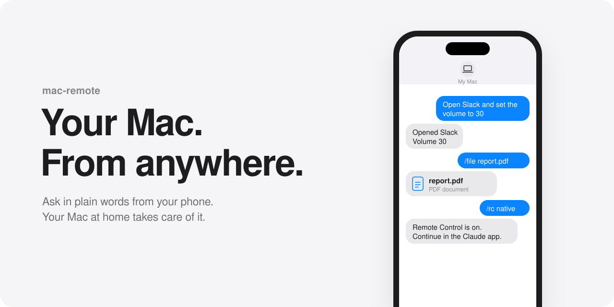

<picture>
  <source media="(prefers-color-scheme: dark)" srcset="assets/hero-dark.svg">
  
</picture>

<p align="center">
  <a href="#get-started">Get started</a> &nbsp;·&nbsp;
  <a href="#what-it-does">What it does</a> &nbsp;·&nbsp;
  <a href="#code-from-anywhere">Code from anywhere</a> &nbsp;·&nbsp;
  <a href="#private-by-design">Privacy</a>
</p>

<br>

**mac-remote** lets you control your Mac from your phone through a private Telegram chat. Write what you need in plain words and your Mac at home does it: sends you a file, opens a link, drafts a Slack message, or starts a Claude Code session in one of your projects.

It runs on your Mac. Nothing is exposed to the internet, and nothing is billed per screenshot.

<br>

## Just ask.

> Take a screenshot.
>
> Send me the invoice from Downloads.
>
> Message Alex on Slack: running ten minutes late.
>
> Open Safari and turn the volume down to 20.

The bot works out what you mean, then does it with a small set of tools it trusts. It never guesses a shell command. For anything that matters, it asks first.

Voice works too. Tap the dictation key on your phone's keyboard and speak.

<br>

## What it does

| | |
|---|---|
| **Status** | Battery, memory, CPU load, free disk and uptime in one message. |
| **Screenshots** | Sent straight to your chat. They never reach the AI. |
| **Apps and sound** | Open or quit any app, set the volume, mute, turn the display off. |
| **Links** | Send a link, or share one from any app, and it opens on your Mac. |
| **Files** | Ask for a file by name. It searches the folders you allow and sends it over. |
| **Slack** | Drafts the message in the right conversation and shows you a screenshot. Nothing is sent until you tap Yes. |
| **Shortcuts** | Runs your Apple Shortcuts by name, so anything Shortcuts can do, the bot can do. |
| **Your commands** | Add your own commands to the config file, with an optional confirm step. |
| **Power alerts** | Tells you when the Mac switches to battery, when power returns, and when the battery runs low. |

<br>

## Code from anywhere

Start real work on your Mac from your phone.

**`/rc`** starts Claude Code Remote Control in a project folder you pick. Continue in the Claude app or at claude.ai/code, with the full interface, permission prompts and your connectors. Even if you forgot to turn Remote Control on before you left, you can still get to your projects.

**`/code`** is for quick questions like "where is the login handled?". Claude Code runs headless in the folder and keeps you posted in one message as it works. Your follow-ups continue the same session.

<br>

## Private by design

- **Only you.** The bot answers only the Telegram chats you list. It ignores everyone else.
- **No open ports.** Your Mac connects out to Telegram. Your router stays closed, and there's no server to rent and no VPN to set up.
- **No free-form commands.** The AI picks from a fixed list of tools, and the code checks every argument. Commands are fixed argument lists and never go through a shell.
- **You confirm what matters.** Restarts, Slack messages and any command you mark need a tap. Each button works once and expires after two minutes.
- **Nothing stale.** Messages that waited more than five minutes, for example while the Mac was offline, are skipped.
- **No extra bill.** By default it uses the Claude Code you already have. Buttons and commands use no AI at all.

<br>

## Get started

You need a Mac, [uv](https://docs.astral.sh/uv/) (`brew install uv`) and [Claude Code](https://claude.com/claude-code), installed and signed in.

**1. Create your bot.** In Telegram, message [@BotFather](https://t.me/BotFather), send `/newbot` and copy the token.

**2. Install.**

```sh
git clone https://github.com/huseyinhobek/mac-remote
cd mac-remote
./install.sh
```

**3. Connect.** Paste the token into `.env`, run `.venv/bin/python bot.py` and message your bot. It replies with your chat ID. Add the ID to `allowed_chat_ids` in `config.toml` and restart the bot.

**4. Make it yours.** In `config.toml`, add your project folders, Shortcuts and commands.

**5. Keep it running.** Install it as a login service that starts with your Mac and restarts if it stops:

```sh
./install.sh service
```

<br>

## Commands

| | |
|---|---|
| Plain text | Do it |
| A link | Open it on the Mac |
| `/status` · `/screenshot` · `/lock` | Same as the buttons |
| `/volume 30` | Set the volume. Without a number, shows a picker |
| `/open Safari` · `/quit Safari` | Open or quit an app |
| `/shortcut Name` | Run an Apple Shortcut from your list |
| `/run name` | Run one of your commands |
| `/file invoice` | Send yourself a file |
| `/rc` · `/rc stop` | Start or stop Remote Control in a folder |
| `/code task` · `/new` · `/stop` | Headless Claude Code in a folder |

<br>

## Configuration

Everything personal lives in `config.toml`, which never leaves your Mac.

```toml
allowed_chat_ids = [123456789]
shortcuts = ["Play Pause", "Focus Work"]
files = ["~/Desktop", "~/Downloads"]
battery_alert = 20

[code.folders]
website = "~/Projects/website"

[commands]
wifi_ip = { run = ["ipconfig", "getifaddr", "en0"] }
restart = { run = ["osascript", "-e", 'tell application "System Events" to restart'], confirm = true }
```

See [`config.example.toml`](config.example.toml) for every option. If you'd rather use an API than Claude Code, any OpenAI-compatible endpoint works:

```toml
[ai]
provider = "openai"
base_url = "https://api.groq.com/openai/v1"
model = "llama-3.3-70b-versatile"
api_key_env = "AI_API_KEY"
```

<br>

## Permissions

macOS asks once for each permission. The service runs its own Python binary, and `./install.sh service` prints its path. To add it in System Settings, press Cmd+Shift+G in the file picker and paste the path.

| To | Allow |
|---|---|
| Use folders in Desktop, Documents or Downloads | Files and Folders |
| Take screenshots | Screen Recording |
| Write Slack messages | Accessibility |
| Quit apps, restart or shut down | Automation |

If the service starts but never logs `started`, it is waiting for folder access. Approve the prompt, or turn the folder on under Files and Folders.

`/lock` turns the display off. To make it a real lock, set System Settings › Lock Screen › Require password to **Immediately**.

<br>

## Keep your Mac reachable

- While the bot runs, your Mac won't go to sleep on its own.
- Closing a MacBook's lid still puts it to sleep. Leave it open, or run `sudo pmset -a disablesleep 1` (`0` turns it back).
- With FileVault on, a restart stops at the disk password screen and nothing can connect until someone logs in. Keep that in mind before a remote restart, and consider turning off automatic macOS update installs.
- If the power goes out, your router usually goes too. The power alert then arrives once power and internet are back.

<br>

## Good to know

- Whoever has your Telegram account can use the bot, `/code` included. Turn on Telegram's two-step verification and keep `[code].allowed_tools` narrow.
- Bot chats aren't end-to-end encrypted. Screenshots, files and `/code` replies pass through Telegram. `/rc` sessions go through Anthropic instead.
- About 550 lines of Python with one dependency. To add a tool, write one function in `tools.py` and register it in `TOOLS`.

<br>

<p align="center"><sub>MIT License</sub></p>
